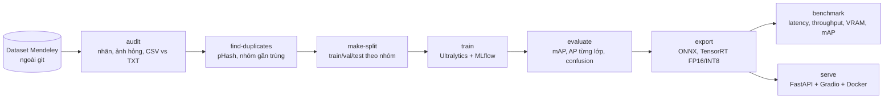
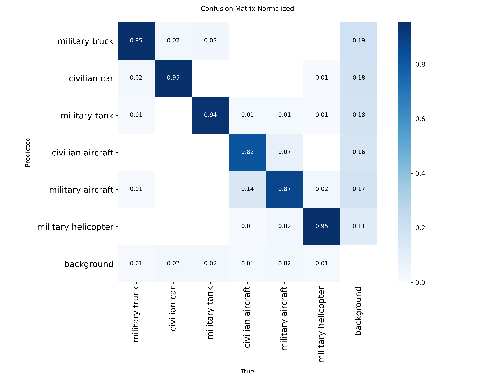

# Military & Civilian Vehicle Detection

[](https://github.com/ngocluong0101/MilitaryAndCivilianVehicles/actions/workflows/ci.yml)

Phát hiện và phân loại 6 lớp phương tiện (`military truck`, `civilian car`, `military tank`,
`civilian aircraft`, `military aircraft`, `military helicopter`) bằng
[Ultralytics](https://github.com/ultralytics/ultralytics) YOLO.

Trọng tâm của project là **quy trình phát triển model bài bản**, không chỉ "chạy train": kiểm tra chất
lượng dữ liệu → chia tập không rò rỉ → thí nghiệm có đối chứng → phân tích lỗi → export và đo tốc độ →
phục vụ model. Số liệu chi tiết nằm trong thư mục `reports/`.

> **Trạng thái kết quả:** dữ liệu, 5 thí nghiệm train (val), kết quả test (một lần) và phân tích lỗi đã có
> số liệu thật (bên dưới), cùng benchmark GPU (ONNX, TensorRT FP16/INT8). Repo không
> điền số ước đoán; mọi con số lấy từ file trong `reports/`.

## Bài toán và điểm đáng chú ý

- **Dữ liệu:** [Mendeley Data](https://data.mendeley.com/datasets/njdjkbxdpn/1) (CC BY 4.0), 6.772 ảnh
  web, 10.718 bbox hợp lệ, 6 lớp. Xem [DATASET.md](DATASET.md).
- **Phát hiện chính của bước kiểm tra dữ liệu:** 4.853/6.772 ảnh (71,7%) thuộc nhóm ảnh trùng/gần trùng
  (chỉ khoảng 4.264 bức ảnh khác nhau). Trong cách chia train/val gốc, **322/496 ảnh val (64,9%) có bản
  gần trùng trong train**, nên mAP đo trên val gốc sẽ bị thổi phồng. Cách chia mới `splits/v2` gom cả
  nhóm vào cùng một tập (0 nhóm nằm ở hai tập) và có thêm tập test riêng.
- **Kỷ luật đánh giá:** mọi lựa chọn dựa trên val; tập test bị khoá trong code (`--final`, chạy một lần).
- **Tái lập:** seed cố định, phiên bản thư viện được pin, mỗi lần train lưu config + môi trường + MLflow.

## Kiến trúc quy trình



## Kết quả

### Dữ liệu (đã đo, nguồn: `reports/`)

| Cách chia | Ảnh train / val / test | Ảnh val có bản gần trùng trong train | Nhóm gần trùng nằm ở >1 tập |
|---|---|---|---|
| `legacy` (gốc) | 6.206 / 496 / – | **322 (64,9%)** | 311 |
| `v2` (mới) | 5.412 / 681 / 679 | 0 | **0** |

### Thí nghiệm trên val (chọn model)

15 epoch, seed 0, imgsz 640, mỗi lượt đổi một thứ; nguồn `reports/experiments/*/val.json` (bảng tự sinh:
`reports/experiments_summary.md`):

| Lượt | Model | Val | mAP50 | mAP50-95 | Lớp yếu nhất (AP50-95) | Train |
|---|---|---|---|---|---|---|
| exp1 | yolov5su | cũ (bị rò rỉ) | 0,792 | 0,540 | civilian aircraft (0,459) | 15 phút |
| exp2 | yolov5su | mới (sạch) | 0,755 | 0,459 | civilian aircraft (0,380) | 14 phút |
| exp3a | YOLO11n | mới (sạch) | 0,771 | **0,468** | civilian aircraft (0,402) | 9 phút |
| exp3b | YOLO11s | mới (sạch) | 0,770 | 0,465 | civilian aircraft (0,383) | 15 phút |
| exp3c | YOLO11n, **30 epoch** | mới (sạch) | **0,788** | **0,480** | civilian aircraft (0,422) | 15 phút |

Cách đọc: (1) exp1 so với exp2 cho thấy chiều hướng val cũ cho số cao hơn (≈ +0,08 mAP50-95), nhưng hai
lượt dùng hai val và hai train khác nhau nên đây **không phải phép đo sạch**. (2) Ba model trên val sạch
chỉ cách nhau 0,009 (một seed, val 681 ảnh) nên chưa phân biệt được về thống kê. (3) Mọi lượt có epoch tốt
nhất là epoch cuối và mAP còn tăng, tức **chưa hội tụ** ở 15 epoch; vì vậy chạy thêm exp3c (chỉ đổi số
epoch lên 30, +0,012 mAP50-95 so với exp3a) và chọn làm model cuối theo val. Chưa chạy lượt imgsz 960.

### Kết quả cuối trên tập test

Model `exp3c` (YOLO11n, 30 epoch), chạy **một lần** trên 679 ảnh test (`reports/test_results.json`):

| mAP50 | mAP50-95 | Precision | Recall |
|---|---|---|---|
| **0,844** | **0,531** | 0,823 | 0,778 |

| Lớp | AP50 | AP50-95 |
|---|---|---|
| military truck | 0,847 | 0,553 |
| civilian car | 0,917 | 0,638 |
| military tank | 0,914 | 0,606 |
| civilian aircraft | 0,810 | 0,497 |
| military aircraft | 0,716 | 0,430 |
| military helicopter | 0,857 | 0,462 |



Lưu ý: test cao hơn val (0,480) khoảng 0,05; với ~680 ảnh và một seed đây chỉ là dao động giữa hai tập,
không phải "model tốt hơn trên test". Lớp yếu nhất đổi chỗ giữa val và test, nên chênh lệch từng lớp chưa
đủ cơ sở kết luận. Chưa đo khoảng tin cậy.

### Phân tích lỗi (val)

Chi tiết và gallery: [reports/error_analysis/error_analysis.md](reports/error_analysis/error_analysis.md).
Ở conf 0,25: 830 đúng, 76 nhầm lớp, 87 định vị sai, 27 trùng, 121 phát hiện thừa, 122 bỏ sót.
- **Cặp nhầm lớn nhất:** civilian aircraft → military aircraft (28/76 ca), nhiều ca mơ hồ về ngữ nghĩa
  (máy bay cánh tam giác, xe Hummer trắng, xe đồ chơi).
- **"Phát hiện thừa" phần lớn là vật thể thật chưa được gán nhãn** (nhãn không đầy đủ), nên precision đo
  được thấp hơn chất lượng thật. Có 12 ca nhãn đáng ngờ được ghi nhận, không sửa nhãn nào.
- **Thử khắc phục nhầm lớp (tăng trọng số loss phân loại `cls` 0,5 → 1,0): không cải thiện** (val mAP50-95
  0,469 so với 0,480; nhầm lớp 79 so với 76). Giữ model exp3c. Xem
  [reports/error_analysis/remedy_comparison.md](reports/error_analysis/remedy_comparison.md).

### Benchmark RTX 4060 Laptop 8 GB

Model `exp3c` (YOLO11n 30 epoch), input 1×3×640×640. Mỗi ô là **trung vị của 3 vòng đo xen kẽ**, trong
ngoặc vuông là khoảng [min–max]; mỗi lần đo chạy trong một tiến trình riêng (VRAM là của riêng định dạng,
gồm CUDA context). Nguồn: `reports/benchmark.csv` (+ `reports/benchmark_runs/README.md`).

| Định dạng | Precision | Latency p50 batch 1 (ms) | Throughput batch 16 (img/s) | VRAM (MB) | mAP50-95 (test) | Kích thước file |
|---|---|---|---|---|---|---|
| PyTorch | FP32 | 4,82 [4,77–6,56] | 309 [178–309] | 672 | 0,5323 | 5,2 MB |
| PyTorch | FP16 | 5,00 [4,93–5,41] | 471 [255–478] | 532 | 0,5319 | 5,2 MB |
| ONNX Runtime (GPU) | FP32 | 3,68 [3,68–8,42] | 159 [113–159] | 1308 | 0,5323 | 10,8 MB |
| TensorRT | FP16 | **1,11** [1,10–1,21] | 651 [633–658] | 1196 | 0,5321 | 7,6 MB |
| TensorRT | INT8 | 1,14 [1,14–1,14] | **767** [766–767] | **1056** | **0,5228** | **4,5 MB** |

Cách đọc:
- **TensorRT FP16 nhanh hơn PyTorch FP32 khoảng 4,3 lần** ở batch 1 (1,11 so với 4,82 ms) và gấp ~2,1 lần ở
  throughput batch 16, mà mAP gần như không đổi (0,5321 so với 0,5323).
- **INT8 không nhanh hơn FP16 ở batch 1** (1,14 so với 1,11 ms; model nhỏ nên bị giới hạn bởi chi phí cố
  định), chỉ tăng ~18% throughput ở batch 16, đổi lại **giảm 0,0095 mAP50-95** (≈ 1,8% tương đối), file nhỏ
  hơn (4,5 MB) và dùng ít VRAM hơn. Với model này, FP16 là điểm cân bằng tốt nhất.
- **Cảnh báo về độ dao động:** GPU laptop bị hãm xung (~780 MHz, giới hạn công suất/nhiệt phần mềm) khi tải nhẹ
  và lên 2250–2550 MHz khi tải nặng kéo dài; ở trạng thái bị hãm TensorRT FP16 là 3,2 ms và INT8 là 2,5 ms.
  Khoảng [min–max] trong bảng phản ánh điều này; **không so sánh số của các định dạng đo ở hai trạng thái xung
  khác nhau**. Chi tiết và các lần đo trước: [reports/benchmark_runs/README.md](reports/benchmark_runs/README.md).
- mAP50-95 ở đây (0,5323) đo bằng quy trình benchmark (batch 8) nên lệch 0,0016 so với 0,5307 của
  `reports/test_results.json` (batch 16); dùng bảng này để so sánh các định dạng với nhau.

### Demo

GIF demo: chưa có (xem [docs/DEMO_RECORDING.md](docs/DEMO_RECORDING.md) để quay).

## Cài đặt

Yêu cầu: Python ≥ 3.10, GPU NVIDIA (đã kiểm tra trên RTX 4060 Laptop 8 GB, driver 595).

```bash
bash scripts/setup_env.sh        # tạo .venv, cài requirements-dev.txt, cài package ở chế độ editable
```

Tương đương: `python3 -m venv .venv`, `pip install -r requirements-dev.txt`, `pip install -e . --no-deps`.
Phiên bản pin trong `requirements.txt`; bản đóng băng đầy đủ ở `requirements-lock.txt`.

## Tái lập từng bước

Tải dataset từ Mendeley, giải nén sao cho có `Images/` và `Labels/`, rồi:

```bash
export DATA_ROOT=/duong/dan/toi/dataset   # mặc định: <repo>/data (đã được .gitignore)

# 1. Dữ liệu: kiểm tra, tìm ảnh trùng, chia tập (cách chia cũ để so sánh)
python -m vehicledet audit             # -> reports/data_audit.md
python -m vehicledet find-duplicates   # -> reports/duplicates.md
python -m vehicledet make-split        # -> splits/v2/, reports/split_stats.md
python -m vehicledet make-legacy-split # -> splits/legacy/

# 2. Thí nghiệm 1–3 (qua đêm; bỏ qua cái đã xong), rồi tổng hợp bảng so sánh
bash scripts/run_experiments.sh
python scripts/summarize_runs.py       # -> reports/experiments_summary.{md,csv}
mlflow ui --backend-store-uri sqlite:///mlflow.db   # xem MLflow local

# 3. Đánh giá trên val; tập test chỉ chạy một lần với model đã chốt
python -m vehicledet evaluate --weights runs/detect/<tên>/weights/best.pt --split v2 --part val
python -m vehicledet evaluate --weights runs/detect/<tên>/weights/best.pt --split v2 --part test --final

# 4. Export + benchmark (TensorRT/onnxruntime-gpu cần cài thêm: docs/TENSORRT_SETUP.md)
python -m vehicledet export --weights runs/detect/<tên>/weights/best.pt --tag <tên>
python -m vehicledet benchmark --model-dir exports/<tên> --map-part val

# 5. Phục vụ model (ONNX Runtime, chạy được cả CPU)
python -m vehicledet serve --model exports/<tên>/best.onnx    # http://127.0.0.1:8000/docs
python -m vehicledet demo  --model exports/<tên>/best.onnx    # Gradio
```

API: `POST /predict` (ảnh + `conf`, `iou`; giới hạn `MAX_UPLOAD_MB`, mặc định 10 MB; lỗi 400/413/422/503)
và `GET /health`.

```bash
# Docker CPU (image ~760 MB, không chứa torch/ultralytics)
mkdir -p models && cp exports/<tên>/best.onnx models/best.onnx
docker compose up --build api                  # API  -> http://localhost:8000/docs
docker compose --profile demo up --build demo  # demo -> http://localhost:7860
```

`docker/Dockerfile.gpu` (profile `gpu`) mới được viết, **chưa kiểm thử**. API đã được chạy thật với model `exp3c`
(ONNX Runtime GPU và Docker CPU cho cùng kết quả; độ khớp với Ultralytics: `reports/serve_parity.json`).
Lần gọi đầu trên GPU chậm (khởi tạo), nên cần warm-up khi triển khai. Đưa demo lên Hugging Face
Spaces: [docs/HF_SPACES.md](docs/HF_SPACES.md).

## Cấu trúc repo

```
configs/        data.yaml (tên lớp), exp*.yaml (mỗi file = một thí nghiệm, chỉ đổi một thứ)
src/vehicledet/ data/ (audit, dedup, make_split...), train, evaluate, export, benchmark, serve/
splits/         danh sách ảnh theo tập: legacy/ và v2/ (train/val/test)
scripts/        setup_env.sh, run_experiments.sh, summarize_runs.py, check_serve_parity.py
tests/          pytest (dữ liệu giả, không cần GPU/dataset)
reports/        kết quả đo (json/csv/png nhỏ) – nguồn của mọi số liệu
docker/ docs/   Dockerfile CPU/GPU; hướng dẫn TensorRT, Hugging Face Spaces, quay demo
```

## Kiểm thử và CI

```bash
python -m pytest                 # 124 test, không cần GPU/dataset
ruff check . && ruff format --check .
```

GitHub Actions (`.github/workflows/ci.yml`) chạy ruff + pytest trên CPU, không cần dataset hay GPU.

## Tài liệu

[DATASET.md](DATASET.md) (dataset card) · [MODEL_CARD.md](MODEL_CARD.md) · [docs/](docs/)

## Giới hạn và sử dụng có trách nhiệm

Project phục vụ học tập/nghiên cứu về computer vision trên ảnh công khai. Không dùng để ra quyết định
giám sát hay quân sự thực tế: phân loại "quân sự/dân sự" theo hình dạng có thể sai, và sai sót có hậu
quả nghiêm trọng. Chi tiết: [MODEL_CARD.md](MODEL_CARD.md).

## License

- Mã dùng **Ultralytics (AGPL-3.0)**: nếu phân phối code hoặc weights huấn luyện bằng Ultralytics, cần
  tuân thủ AGPL-3.0 (hoặc có giấy phép doanh nghiệp của Ultralytics).
- Dataset: **CC BY 4.0** (Gupta, Pareek, Singal, Rao; DRDO Institute for System Studies and Analyses).
  Ảnh gốc có thể có bản quyền riêng; không phân phối lại ảnh.
- Chưa chọn license cho mã nguồn của riêng repo này.
