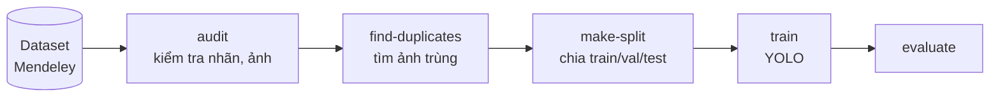

# Military & Civilian Vehicle Detection

[](https://github.com/ngocluong0101/MilitaryAndCivilianVehicles/actions/workflows/ci.yml)

Hệ thống nhận diện phương tiện trong ảnh: đưa vào một bức ảnh, hệ thống khoanh vùng từng phương tiện và
cho biết đó là loại nào trong 6 loại — `military truck` (xe tải quân sự), `civilian car` (ô tô dân sự),
`military tank` (xe tăng), `civilian aircraft` (máy bay dân dụng), `military aircraft` (máy bay quân sự),
`military helicopter` (trực thăng quân sự). Xây dựng trên [Ultralytics YOLO](https://github.com/ultralytics/ultralytics).

Project đi qua : **kiểm tra dữ liệu → chia tập đúng cách →
huấn luyện → đánh giá**.



## Điểm nổi bật

| Khía cạnh | Vấn đề thường gặp | Dự án này làm gì | Kết quả |
|---|---|---|---|
| **Dữ liệu** | Ảnh giống nhau nằm ở cả tập huấn luyện và tập kiểm tra khiến điểm số cao ảo | Dò ảnh trùng bằng perceptual hash, chia lại dữ liệu theo từng nhóm ảnh trùng | **71,7%** ảnh có bản trùng; **64,9%** ảnh kiểm tra của cách chia gốc có bản sao trong tập huấn luyện; sau khi chia lại: 0 nhóm bị tách |
| **Đánh giá** | Chọn model trên tập test làm số cuối bị lạc quan | Khoá tập test trong code (chỉ chạy một lần); mỗi thí nghiệm chỉ đổi một yếu tố, kết quả lưu trong `reports/experiments/` | mAP50-95 **0,531** trên 679 ảnh test độc lập |
| **Kiểm thử** | Mã khó tái lập, dễ hỏng âm thầm | Kiểm thử tự động chạy trên CPU với dữ liệu giả, CI chạy mỗi lần push | Xem mục [Kiểm thử](#kiểm-thử) |
| **Trung thực** | Chỉ công bố kết quả đẹp | Ghi lại cả thí nghiệm không cải thiện và các lỗi đo đạc đã sửa | Toàn bộ trong [reports/](reports/) |

## Kết quả

### Trên tập test (model YOLO11n, 30 epoch, chạy một lần, 679 ảnh)

| mAP50 | mAP50-95 | Precision | Recall |
|---|---|---|---|
| **0,844** | **0,531** | 0,823 | 0,778 |

| Lớp | AP50 | AP50-95 |
|---|---|---|
| military truck | 0,847 | 0,553 |
| civilian car | 0,917 | 0,638 |
| military tank | 0,914 | 0,606 |
| civilian aircraft | 0,810 | 0,497 |
| military aircraft | 0,716 | 0,430 |
| military helicopter | 0,857 | 0,462 |


### So sánh các model trên tập kiểm định (val)

| Thí nghiệm | Model | mAP50-95 |
|---|---|---|
| exp2 | YOLOv5s (YOLOv5su), 15 epoch | 0,459 |
| exp3a | YOLO11n, 15 epoch | 0,468 |
| exp3b | YOLO11s, 15 epoch | 0,465 |
| **exp3c** | **YOLO11n, 30 epoch** (model được chọn) | **0,480** |

Nguồn: `reports/experiments_summary.md` và `reports/experiments/` (chỉ còn chi tiết của exp3c; bảng tổng hợp có đủ các lượt).

## Bắt đầu nhanh

**Yêu cầu:** Python ≥ 3.10; GPU NVIDIA để huấn luyện (đã chạy trên RTX 4060 Laptop 8 GB).

### 1. Cài đặt

```bash
git clone https://github.com/ngocluong0101/MilitaryAndCivilianVehicles.git
cd MilitaryAndCivilianVehicles
bash scripts/setup_env.sh          # tạo môi trường ảo .venv và cài thư viện (đã pin phiên bản)
source .venv/bin/activate
```

### 2. Chuẩn bị dữ liệu

Tải dataset [Military and Civilian Vehicles Classification](https://data.mendeley.com/datasets/njdjkbxdpn/1)
(Mendeley Data, CC BY 4.0), giải nén sao cho có hai thư mục `Images/` và `Labels/`, rồi trỏ tới đó:

```bash
export DATA_ROOT=/duong/dan/toi/dataset      # mặc định: thư mục data/ trong repo
python -m vehicledet audit                   # kiểm tra chất lượng dữ liệu  -> reports/data_audit.md
python -m vehicledet find-duplicates         # tìm ảnh trùng                -> reports/duplicates.md
python -m vehicledet make-split              # chia train/val/test          -> splits/v2/
```

### 3. Huấn luyện và đánh giá

```bash
python -m vehicledet train --config configs/exp3c_yolo11n_v2_640_30ep.yaml   # ~15 phút trên RTX 4060 Laptop
python -m vehicledet evaluate --weights runs/detect/exp3c_yolo11n_v2_640_30ep/weights/best.pt --split v2 --part val
```

Mỗi lần huấn luyện được lưu vào `runs/`, kèm báo cáo gọn trong `reports/experiments/<tên>/`. Config chỉ còn
model cuối (`exp3c`); các config thí nghiệm so sánh cũ (exp1–exp6) và kết quả chi tiết của chúng nằm trong git history.

Tập test chỉ dùng được một lần, sau khi đã chọn xong model:

```bash
python -m vehicledet evaluate --weights <đường dẫn best.pt> --split v2 --part test --final
```

## Cấu trúc thư mục

```
configs/        cấu hình từng thí nghiệm (YAML) và tên 6 lớp
src/vehicledet/ mã nguồn: data/ (kiểm tra, chia tập), train, evaluate
splits/         danh sách ảnh của từng tập train/val/test
scripts/        cài môi trường, chạy hàng loạt thí nghiệm, tổng hợp kết quả
tests/          79 bài kiểm thử (dùng dữ liệu giả, không cần GPU hay dataset)
reports/        toàn bộ kết quả đo (json, csv, ảnh): nguồn của mọi con số trong tài liệu này
```

## Kiểm thử

```bash
python -m pytest                      # 79 bài kiểm thử, chạy trên CPU, không cần dataset
ruff check . && ruff format --check .
```

GitHub Actions (`.github/workflows/ci.yml`) tự chạy `ruff` và `pytest` mỗi lần push.

## Tài liệu

[DATASET.md](DATASET.md) (mô tả dữ liệu, các vấn đề đã phát hiện) · [MODEL_CARD.md](MODEL_CARD.md) (mục đích,
giới hạn, sử dụng có trách nhiệm)

## Giới hạn và sử dụng có trách nhiệm

- Kết quả đến từ một lần huấn luyện (một seed) và các tập kiểm định/test chỉ khoảng 680 ảnh, chưa có khoảng
  tin cậy.
- Dữ liệu là ảnh thu thập từ web, ít vật thể nhỏ, chưa kiểm tra với ảnh vệ tinh, UAV hay ban đêm; phân loại
  "quân sự/dân sự" theo hình dạng có thể sai.
- Project chỉ phục vụ học tập và nghiên cứu về thị giác máy tính trên ảnh công khai. Không dùng để ra quyết
  định giám sát hay quân sự thực tế.

## License

- Mã dùng **Ultralytics (AGPL-3.0)**: nếu phân phối mã hoặc trọng số huấn luyện bằng Ultralytics thì cần tuân
  thủ AGPL-3.0 (hoặc có giấy phép doanh nghiệp của Ultralytics).
- Dataset: **CC BY 4.0** (Gupta, Pareek, Singal, Rao; DRDO Institute for System Studies and Analyses). Ảnh gốc
  có thể có bản quyền riêng; không phân phối lại ảnh.
- Chưa chọn license cho mã nguồn riêng của repo này.

---

@author: Ngoc Luong <ngocluongg0101@gmail.com>
