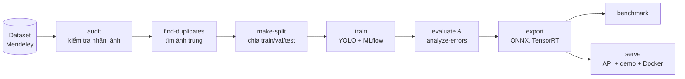

# Military & Civilian Vehicle Detection

[](https://github.com/ngocluong0101/MilitaryAndCivilianVehicles/actions/workflows/ci.yml)

Hệ thống nhận diện phương tiện trong ảnh: đưa vào một bức ảnh, hệ thống khoanh vùng từng phương tiện và
cho biết đó là loại nào trong 6 loại — `military truck` (xe tải quân sự), `civilian car` (ô tô dân sự),
`military tank` (xe tăng), `civilian aircraft` (máy bay dân dụng), `military aircraft` (máy bay quân sự),
`military helicopter` (trực thăng quân sự). Xây dựng trên [Ultralytics YOLO](https://github.com/ultralytics/ultralytics).

Project đi qua đủ vòng đời của một model thị giác máy tính: **kiểm tra dữ liệu → chia tập đúng cách →
huấn luyện có đối chứng → phân tích lỗi → tối ưu tốc độ → đóng gói thành API, demo và Docker**.



## Điểm nổi bật

Phần lớn dự án học máy dừng ở việc "huấn luyện ra một con số". Dự án này tập trung vào những chỗ thường bị bỏ qua
nhưng quyết định kết quả có đáng tin hay không:

| Khía cạnh | Vấn đề thường gặp | Dự án này làm gì | Kết quả |
|---|---|---|---|
| **Dữ liệu** | Ảnh giống nhau nằm ở cả tập huấn luyện và tập kiểm tra khiến điểm số cao ảo | Dò ảnh trùng bằng perceptual hash, chia lại dữ liệu theo từng nhóm ảnh trùng | **71,7%** ảnh có bản trùng; **64,9%** ảnh kiểm tra của cách chia gốc có bản sao trong tập huấn luyện; sau khi chia lại: 0 nhóm bị tách |
| **Đánh giá** | Chọn model trên tập test làm số cuối bị lạc quan | Khoá tập test trong code (chỉ chạy một lần); mỗi thí nghiệm chỉ đổi một yếu tố, lưu bằng MLflow | mAP50-95 **0,531** trên 679 ảnh test độc lập |
| **Tốc độ** | Model chính xác nhưng quá chậm để dùng | Export ONNX/TensorRT, đo độ trễ, thông lượng, VRAM và độ chính xác của từng định dạng | TensorRT FP16 nhanh **≈ 4 lần** PyTorch FP32 (4,82 → 1,11 ms/ảnh), độ chính xác gần như không đổi |
| **Triển khai** | Model chỉ nằm trong notebook | API FastAPI, demo Gradio, Docker CPU (~760 MB), kiểm thử tự động chạy trên CI | **124** bài kiểm thử; chạy được cả trên CPU |
| **Trung thực** | Chỉ công bố kết quả đẹp | Ghi lại cả thí nghiệm không cải thiện và các lỗi đo đạc đã sửa | Toàn bộ trong [reports/](reports/) |

## Kết quả

### Trên tập test (model YOLO11n, 30 epoch, chạy một lần, 679 ảnh)

| mAP50 | mAP50-95 | Precision | Recall |
|---|---|---|---|
| **0,844** | **0,531** | 0,823 | 0,778 |

| Lớp | AP50 | AP50-95 |
|---|---|---|
| military truck | 0,847 | 0,553 |
| civilian car | 0,917 | 0,638 |
| military tank | 0,914 | 0,606 |
| civilian aircraft | 0,810 | 0,497 |
| military aircraft | 0,716 | 0,430 |
| military helicopter | 0,857 | 0,462 |


### So sánh các model trên tập kiểm định (val)

| Thí nghiệm | Model | mAP50-95 |
|---|---|---|
| exp2 | YOLOv5s (YOLOv5su), 15 epoch | 0,459 |
| exp3a | YOLO11n, 15 epoch | 0,468 |
| exp3b | YOLO11s, 15 epoch | 0,465 |
| **exp3c** | **YOLO11n, 30 epoch** (model được chọn) | **0,480** |

Nguồn: `reports/experiments_summary.md` và `reports/experiments/`.

### Tốc độ trên RTX 4060 Laptop (model đã chọn, ảnh 640×640)

| Định dạng | Thời gian xử lý 1 ảnh (ms) | Số ảnh/giây (batch 16) | VRAM (MB) | mAP50-95 (test) |
|---|---|---|---|---|
| PyTorch FP32 | 4,82 | 309 | 672 | 0,5323 |
| PyTorch FP16 | 5,00 | 471 | 532 | 0,5319 |
| ONNX Runtime (GPU) | 3,68 | 159 | 1308 | 0,5323 |
| **TensorRT FP16** | **1,11** | 651 | 1196 | 0,5321 |
| TensorRT INT8 | 1,14 | **767** | 1056 | 0,5228 |

Nguồn: `reports/benchmark.csv`; chi tiết các lần đo ở `reports/benchmark_runs/README.md`.

### Phân tích lỗi

Lỗi model hay gặp nhất là nhầm máy bay dân dụng thành máy bay quân sự (28 trên tổng 76 ca nhầm lớp), nhiều ca
vốn mơ hồ ngay cả với người xem. Nhiều trường hợp "phát hiện thừa" thực chất là vật thể thật mà dataset
chưa gán nhãn. Báo cáo kèm ảnh minh hoạ: [reports/error_analysis/error_analysis.md](reports/error_analysis/error_analysis.md).

## Bắt đầu nhanh

**Yêu cầu:** Python ≥ 3.10; GPU NVIDIA để huấn luyện (đã chạy trên RTX 4060 Laptop 8 GB). API và demo chạy
được cả trên CPU.

### 1. Cài đặt

```bash
git clone https://github.com/ngocluong0101/MilitaryAndCivilianVehicles.git
cd MilitaryAndCivilianVehicles
bash scripts/setup_env.sh          # tạo môi trường ảo .venv và cài thư viện (đã pin phiên bản)
source .venv/bin/activate
```

### 2. Chuẩn bị dữ liệu

Tải dataset [Military and Civilian Vehicles Classification](https://data.mendeley.com/datasets/njdjkbxdpn/1)
(Mendeley Data, CC BY 4.0), giải nén sao cho có hai thư mục `Images/` và `Labels/`, rồi trỏ tới đó:

```bash
export DATA_ROOT=/duong/dan/toi/dataset      # mặc định: thư mục data/ trong repo
python -m vehicledet audit                   # kiểm tra chất lượng dữ liệu  -> reports/data_audit.md
python -m vehicledet find-duplicates         # tìm ảnh trùng                -> reports/duplicates.md
python -m vehicledet make-split              # chia train/val/test          -> splits/v2/
```

### 3. Huấn luyện và đánh giá

```bash
python -m vehicledet train --config configs/exp3c_yolo11n_v2_640_30ep.yaml   # ~15 phút trên RTX 4060 Laptop
python -m vehicledet evaluate --weights runs/detect/exp3c_yolo11n_v2_640_30ep/weights/best.pt --split v2 --part val
python -m vehicledet analyze-errors --weights runs/detect/exp3c_yolo11n_v2_640_30ep/weights/best.pt
```

Mỗi lần huấn luyện được lưu vào `runs/` và MLflow (`mlflow ui --backend-store-uri sqlite:///mlflow.db`), kèm
báo cáo gọn trong `reports/experiments/`. Các cấu hình thí nghiệm khác nằm ở `configs/`.

Tập test chỉ dùng được một lần, sau khi đã chọn xong model:

```bash
python -m vehicledet evaluate --weights <đường dẫn best.pt> --split v2 --part test --final
```

### 4. Xuất model và đo tốc độ

```bash
# Xuất ONNX (chạy được trên CPU)
python -m vehicledet export --weights runs/detect/exp3c_yolo11n_v2_640_30ep/weights/best.pt \
    --tag exp3c --formats onnx --device cpu

# Xuất thêm TensorRT FP16/INT8 và đo tốc độ (cần GPU NVIDIA + TensorRT, xem docs/TENSORRT_SETUP.md)
python -m vehicledet export --weights runs/detect/exp3c_yolo11n_v2_640_30ep/weights/best.pt --tag exp3c
python -m vehicledet benchmark --model-dir exports/exp3c
```

### 5. Chạy API và demo

Model đã huấn luyện không đi kèm repo (file nặng và ràng buộc license), nên cần làm các bước trên để có
`exports/exp3c/best.onnx`.

```bash
python -m vehicledet serve --model exports/exp3c/best.onnx        # API tại http://127.0.0.1:8000/docs
python -m vehicledet demo  --model exports/exp3c/best.onnx        # giao diện web Gradio tại http://127.0.0.1:7860
```

Gọi API:

```bash
curl -F "file=@anh.jpg" "http://127.0.0.1:8000/predict?conf=0.25"
```

```json
{
  "image": {"width": 1200, "height": 755},
  "detections": [
    {"class_id": 2, "label": "military tank", "score": 0.6086,
     "bbox": {"x1": 354.3, "y1": 261.4, "x2": 1041.0, "y2": 524.9}}
  ],
  "inference_ms": 42.48, "total_ms": 59.6, "backend": "onnxruntime (CPU)"
}
```

- `POST /predict`: nhận ảnh JPEG/PNG/WebP/BMP, tham số `conf` (ngưỡng tin cậy) và `iou`; giới hạn kích thước
  mặc định 10 MB (đổi bằng biến môi trường `MAX_UPLOAD_MB`). Lỗi trả về rõ ràng: 400 (ảnh không hợp lệ),
  413 (quá lớn), 422 (tham số sai), 503 (model chưa nạp).
- `GET /health`: kiểm tra dịch vụ và model đã sẵn sàng chưa.

### Chạy bằng Docker (CPU)

```bash
mkdir -p models && cp exports/exp3c/best.onnx models/best.onnx
docker compose up --build api                    # API  -> http://localhost:8000/docs
docker compose --profile demo up --build demo    # demo -> http://localhost:7860
```

Image CPU nhỏ (~760 MB), không chứa PyTorch hay Ultralytics.

## Cấu trúc thư mục

```
configs/        cấu hình từng thí nghiệm (YAML) và tên 6 lớp
src/vehicledet/ mã nguồn: data/ (kiểm tra, chia tập), train, evaluate, export, benchmark, serve/ (API, demo)
splits/         danh sách ảnh của từng tập train/val/test
scripts/        cài môi trường, chạy hàng loạt thí nghiệm, tổng hợp kết quả
tests/          124 bài kiểm thử (dùng dữ liệu giả, không cần GPU hay dataset)
reports/        toàn bộ kết quả đo (json, csv, ảnh): nguồn của mọi con số trong tài liệu này
docker/ docs/   Dockerfile, hướng dẫn cài TensorRT
```

## Kiểm thử

```bash
python -m pytest                      # 124 bài kiểm thử, chạy trên CPU, không cần dataset
ruff check . && ruff format --check .
```

GitHub Actions (`.github/workflows/ci.yml`) tự chạy `ruff` và `pytest` mỗi lần push.

## Tài liệu

[DATASET.md](DATASET.md) (mô tả dữ liệu, các vấn đề đã phát hiện) · [MODEL_CARD.md](MODEL_CARD.md) (mục đích,
giới hạn, sử dụng có trách nhiệm) · [docs/TENSORRT_SETUP.md](docs/TENSORRT_SETUP.md)

## Giới hạn và sử dụng có trách nhiệm

- Kết quả đến từ một lần huấn luyện (một seed) và các tập kiểm định/test chỉ khoảng 680 ảnh, chưa có khoảng
  tin cậy; số liệu tốc độ phụ thuộc xung nhịp của GPU laptop (có thể dao động vài lần giữa các lần đo).
- Dữ liệu là ảnh thu thập từ web, ít vật thể nhỏ, chưa kiểm tra với ảnh vệ tinh, UAV hay ban đêm; phân loại
  "quân sự/dân sự" theo hình dạng có thể sai.
- Project chỉ phục vụ học tập và nghiên cứu về thị giác máy tính trên ảnh công khai. Không dùng để ra quyết
  định giám sát hay quân sự thực tế.

## License

- Mã dùng **Ultralytics (AGPL-3.0)**: nếu phân phối mã hoặc trọng số huấn luyện bằng Ultralytics thì cần tuân
  thủ AGPL-3.0 (hoặc có giấy phép doanh nghiệp của Ultralytics).
- Dataset: **CC BY 4.0** (Gupta, Pareek, Singal, Rao; DRDO Institute for System Studies and Analyses). Ảnh gốc
  có thể có bản quyền riêng; không phân phối lại ảnh.
- Chưa chọn license cho mã nguồn riêng của repo này.
